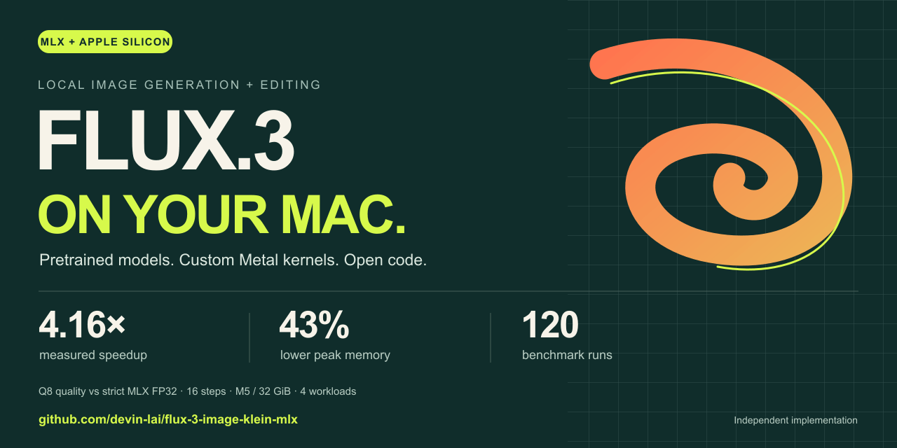
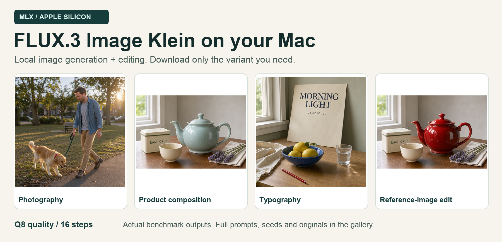

<div align="center">



# FLUX.3 Image Klein · MLX

**Generate and edit images locally on your Mac. Download a model. Run a command.**

[](USAGE.md)
[](pyproject.toml)
[](LICENSE)
[](https://huggingface.co/devin-lai/flux-3-image-klein-mlx)
[](https://github.com/devin-lai/flux-3-image-klein-mlx/actions/workflows/ci.yml)

[Quick start](#quick-start) · [Benchmarks](#measured-on-a-macbook-pro-m5--32-gib) · [Gallery](gallery/README.md) · [How it works](docs/OPTIMIZATION.md) · [Model downloads](#choose-your-model)

</div>

An independent Apple Silicon implementation of Black Forest Labs' pretrained [FLUX.3 Image Klein](https://huggingface.co/black-forest-labs/flux-3-image-klein). Native **MLX/Metal inference**, text-to-image generation, reference-image editing, custom fused kernels, and five ready-to-run weight configurations. **No training or conversion required.**

**Measured on M5 / 32 GiB:** Q8 quality at 16 steps ran **4.16× faster** than our strict MLX FP32 reference, with **43% lower peak process memory**. The faster 11-step preset reached **5.43×** in a later measurement round. These compare complete pipeline configurations; the reference is described below.



*Actual 16-step benchmark outputs, resized for display. [Prompts, seeds, inputs, comparisons and original PNGs →](gallery/README.md)*

## Quick start

**Requirements:** Apple Silicon Mac, Python 3.12, and enough disk space for your selected model. Validated on M5 with 32 GiB unified memory; minimum supported memory has not been established.

```sh
git clone https://github.com/devin-lai/flux-3-image-klein-mlx.git
cd flux-3-image-klein-mlx
python3.12 -m venv .venv
source .venv/bin/activate
python -m pip install -e '.[hub]'

# First run downloads only the selected pretrained model from Hugging Face.
flux-klein --download q8-quality --model-dir ../flux-models/q8-quality \
  --preset q8-quality-16 --prompt-file examples/teapot.json \
  --width 768 --height 512 --seed 1937 --out ../flux-output/teapot.png
```

After the first download, omit `--download` for local inference. Choose a new output filename for each run. Models and outputs go outside this checkout. The first checksum verification reads the selected weights and takes additional time.

**Try the faster preset:** replace `--preset q8-quality-16` with `--preset q8-quality-11`. **Edit a reference image:** add `--image /path/to/reference.png` and use `--prompt-file examples/editing.json` with your own full scene caption. The CLI accepts your caption verbatim; use a detailed caption or expand your request with an LLM first.

[Full setup, offline use, editing and troubleshooting →](USAGE.md)

## Measured on a MacBook Pro M5 · 32 GiB

**120 fresh-process runs · 4 workloads · 3 repeats per configuration and workload.** Canvases range from 640 × 640 to 1024 × 1024 and include a reference-image edit. Latency is the geometric mean of four per-workload medians; it is not a single 1024 × 1024 image time. Memory is maximum lifetime process physical footprint, including Metal allocations.

| Configuration | Steps | Launch time ↓ | Speedup ↑ | Peak memory ↓ | LPIPS ↓ |
|---|---:|---:|---:|---:|---:|
| Strict MLX FP32 reference | 16 | 161.16 s | 1.00× | 12.98 GiB | 0.000000 |
| BF16 | 16 | 40.34 s | 4.00× | 12.47 GiB | 0.000174 |
| **Q8 quality · recommended** | **16** | **38.75 s** | **4.16×** | **7.46 GiB** | **0.003246** |
| Q8 | 16 | 36.65 s | 4.40× | 7.43 GiB | 0.004196 |
| Mixed 4/8-bit | 16 | 34.91 s | 4.62× | 6.07 GiB | 0.046897 |
| Q4 | 16 | 33.75 s | 4.77× | 5.53 GiB | 0.054543 |
| **Q8 quality · faster preset** | **11** | **29.69 s** | **5.43×*** | **7.33 GiB** | **0.008134** |

*11-step timing is from a later round on the same machine. Reduced steps change the sampling trajectory. LPIPS measures agreement with the fixed FP32-16 reference, not visual preference. Q4/mixed show larger visual differences; Q4 added an extra pencil in the typography test.*

**What the baseline means.** The reference upcasts the released BF16 weights on demand and runs strict FP32 arithmetic, portable kernels and FP32 VAE decoding. Accelerated presets combine scaled FP16 matrix multiplication, FP32 residual/conditioning calculations, fused kernels, FP16 VAE execution and optional weight quantization. The ratios measure these configured pipelines together. They do not isolate quantization or establish speedups over Diffusers, CUDA, Core ML or other Mac apps.

For a concrete size: the **768 × 512 teapot** took **25.47 s** with Q8 quality at 16 steps and **19.78 s** at 11 steps; the **1024 × 1024 photo** took **66.61 s** and **50.99 s** respectively.

[Full methodology, ranges, PSNR/SSIM/LPIPS and stage timings](reports/macbook-pro-32gb.md) · [Raw measurements](results/m5-32gb-16step.json) · [Reduced-step measurements](results/m5-32gb-presets.json) · [Reproduce and audit](benchmarks/README.md)

## What makes this implementation useful

- **Native MLX on Metal.** Image transformer, text encoding and autoencoder run through MLX. Torch runs in a separate CPU worker for reference-compatible seeded noise and timesteps.
- **Memory-aware execution.** Text layers stream sequentially; text encoder, transformer and VAE have separate lifetimes. Packed quantized weights avoid keeping a dense copy of every matrix.
- **Custom fused kernels.** QKV normalization/rotary operations and modulation/residual operations reduce intermediate tensors and dispatch overhead. [Read the implementation map.](docs/OPTIMIZATION.md)
- **Ready-to-run pretrained weights.** Download one complete variant from Hugging Face, with checksum manifests, tokenizer, VAE and editing components.
- **Evidence you can inspect.** Exact presets, 120 timing records, 22-case archived quality validation, original comparison images, and observed failure cases.

## Choose your model

| Model | Complete download | Transformer / text | Best starting point |
|---|---:|---|---|
| **[Q8 quality](https://huggingface.co/devin-lai/flux-3-image-klein-mlx-q8-quality)** | **12.73 GiB** | Q8 / BF16 | Recommended fidelity/storage balance |
| [Q8](https://huggingface.co/devin-lai/flux-3-image-klein-mlx-q8) | 9.58 GiB | Q8 / Q8 | Smaller download |
| [Mixed](https://huggingface.co/devin-lai/flux-3-image-klein-mlx-mixed) | 8.23 GiB | Mixed 4/8 / Q8 | Lower memory, larger visual changes |
| [Q4](https://huggingface.co/devin-lai/flux-3-image-klein-mlx-q4) | 7.40 GiB | Q4 / Q8 | Smallest download, stronger fidelity tradeoffs |
| [BF16](https://huggingface.co/devin-lai/flux-3-image-klein-mlx-bf16) | 17.40 GiB | BF16 / BF16 | Unquantized weight control |

Each is a complete configuration. Use a separate model directory for each variant. Download size and peak process memory are different quantities. [All nine presets](PRESETS.md) · [Selection guide](MODEL_SELECTION.md) · [Pinned model revisions](models.json)

## Stack comparison

| Stack | Execution and format | Choose it for | Timing evidence here |
|---|---|---|---|
| **This runtime** | MLX + Metal; packed BF16/Q8/mixed/Q4 weights | Local Apple Silicon generation and editing | M5/32 GiB measurements above |
| [BFL reference implementation](https://github.com/black-forest-labs/flux-3-image-klein) | PyTorch; upstream checkpoints; prompt upsampler integration | Upstream behavior and supported reference workflows | FP32 output alignment only; no latency comparison |
| [Hugging Face Diffusers](https://huggingface.co/black-forest-labs/flux-3-image-klein#using-with-diffusers) | Modular pipeline and ecosystem integrations | Existing Diffusers applications | Not benchmarked |

This project uses a dedicated packed format; it is not a drop-in Diffusers pipeline. Hardware and pipeline settings must match before comparing performance. [Architecture, numerical choices and limits →](docs/OPTIMIZATION.md)

## Explore, reproduce, contribute

| I want to… | Start here |
|---|---|
| Generate or edit an image | [Usage guide](USAGE.md) |
| Inspect quality and failure cases | [Gallery](gallery/README.md) and [results](RESULTS.md) |
| Understand an optimization | [Code and architecture map](docs/OPTIMIZATION.md) |
| Run benchmarks on my Mac | [Benchmark guide](benchmarks/README.md) |
| Audit the published speedups | `python scripts/audit_benchmarks.py` |
| Report a bug or contribute | [Contributing](CONTRIBUTING.md) and [issues](https://github.com/devin-lai/flux-3-image-klein-mlx/issues) |

**Help build the Mac benchmark map.** Share your chip, memory, preset, command and measured results using the benchmark issue template. If this project helps you, a star makes it easier for other Mac users to find it.

## License and attribution

The inference runtime is **[Apache-2.0](LICENSE)**. Pretrained model weights retain the **[FLUX Kommunity License](licenses/FLUX-KOMMUNITY.md)**; the text encoder retains [Apache-2.0](LICENSE-text-encoder.txt). Model availability does not make the weights unrestricted open-source software. See [NOTICE](NOTICE.md) and the [upstream model card](https://huggingface.co/black-forest-labs/flux-3-image-klein) for attribution and model limitations.

This independent derivative is not endorsed by Black Forest Labs. It repacks and quantizes pretrained weights; no new training dataset is introduced. This release contains inference source and benchmark tooling. Conversion/calibration tooling is outside its scope. The CLI does not bundle the upstream prompt upsampler or content filter; follow the model license's applicable terms.
