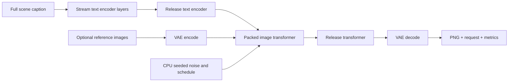

# How the MLX implementation works

The goal is practical local inference from a public pretrained model. All model computation runs through MLX on Metal. The code preserves the upstream architecture while changing weight layout, arithmetic, kernel fusion and component lifetimes.

## Execution path

Text features and optional reference latents survive between stages; complete model components do not all remain resident together. A separate CPU Torch worker generates the reference-compatible random noise and timestep schedule. It does not perform model inference or hold a GPU Torch allocator.

## Optimization map

| Change | Why it helps | Source |
|---|---|---|
| Packed projections and affine Q8/Q4/mixed weights | Direct MLX quantized matmul; avoids persistent dense dequantized copies | [`engine.py`](../flux_klein_mlx/engine.py), `Weights.linear` and `Block` |
| Scaled FP16 matrix operands with FP32 residual/conditioning calculations | Uses fast matrix arithmetic while controlling activation range | [`engine.py`](../flux_klein_mlx/engine.py), `Weights.linear` |
| Fused QKV normalization and rotary position operations | Reduces intermediate arrays and separate kernel dispatches | [`fast_kernels.py`](../flux_klein_mlx/fast_kernels.py) |
| Compact modulation and residual kernels | Combines elementwise work used repeatedly in transformer blocks | [`compact_kernels.py`](../flux_klein_mlx/compact_kernels.py) |
| Streamed text layers and selected embedding rows | Limits text-model residency; reads only required vocabulary rows | [`engine.py`](../flux_klein_mlx/engine.py), `TextEncoder` and `load_embedding_rows` |
| Sequential component lifetimes, explicit release and 512 MiB cache | Bounds retained model and allocator memory | [`pipeline.py`](../flux_klein_mlx/pipeline.py), [`presets.json`](../presets.json) |
| FP16 VAE execution in accelerated presets | Reduces decoding work and memory relative to the FP32 control | [`vae.py`](../flux_klein_mlx/vae.py) |
| Validated nonuniform 11/12/13-step grids | Reduces transformer evaluations while retaining selected full-suite quality criteria | [`PRESETS.md`](../PRESETS.md), [`validated-presets.md`](../reports/validated-presets.md) |

These changes were measured together as configured pipelines. There is no controlled ablation assigning a separate speedup to each row. Q8 quality at 16 steps is 4.16× faster than the measured strict MLX FP32 configuration. It uses 7.46 GiB maximum process footprint versus 12.98 GiB, a 42.5% reduction (43% rounded).

## Precision and fidelity

Stored weight precision is separate from inference arithmetic. BF16 stores unquantized released checkpoint values. Q8 quality combines Q8 transformer weights with BF16 text weights; Q8 quantizes both. Mixed and Q4 reduce storage and memory further but produce larger reference differences.

The strict FP32 reference upcasts the original BF16 values on demand. It uses portable kernels, FP32 VAE execution and TF32 disabled. Accelerated presets use scaled FP16 matrix multiplication with FP32 conditioning, residual and integration calculations. Their VAE runs in FP16. No unpublished FP32 master checkpoint is implied.

The four local strict FP32 results agree with hash-locked official-code FP32 images to a maximum of one 8-bit channel code. Similarity is not aesthetic preference. Exact object counts can change, particularly with mixed/Q4; inspect the complete image stacks.

## Where this fits in the stack

The [BFL reference implementation](https://github.com/black-forest-labs/flux-3-image-klein) is the upstream reference for architecture and prompting. [Diffusers](https://huggingface.co/black-forest-labs/flux-3-image-klein#using-with-diffusers) offers modular pipeline integration. This runtime targets Apple Silicon using [MLX](https://ml-explore.github.io/mlx/build/html/index.html), its Metal kernels, unified-memory execution and a dedicated packed format.

There are no controlled latency comparisons here against PyTorch/MPS, CUDA, Diffusers or Core ML. Upstream GPU-memory figures use different hardware and measurement definitions and should not be divided by the Mac process-footprint values to claim a memory speedup.

## Repository map

- `flux_klein_mlx/`: inference runtime, kernels, CLI, model verification and optional Hub downloads.
- `examples/`: complete scene captions for generation and editing.
- `benchmarks/` and `scripts/`: fresh-process benchmark runner and published-data audit.
- `results/` and `reports/`: machine-readable measurements and methodology.
- `gallery/`: parameter-labeled comparisons with original PNGs hosted on Hugging Face.
- `models.json`: public model repository IDs and pinned release revisions.

The inference runtime is open source under Apache-2.0. The separate pretrained weight licenses remain applicable. Conversion, calibration and private experiment tooling are outside this release.
